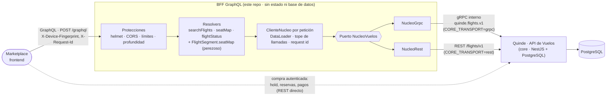

# Arquitectura

El marketplace hace **una** consulta GraphQL al BFF; el BFF la resuelve contra el core con las
tres lecturas públicas (`SearchFlights`, `GetSeatMap`, `GetFlightStatus`). La compra autenticada no
pasa por aquí: sigue por REST directo al core (línea punteada).

## Por qué un BFF

- **Una consulta, varias lecturas.** Sin él, el frontend hace `POST /search` y luego un
  `GET /offers/{id}/seatmap?segmentId=` por cada segmento que quiere mostrar, cada uno un viaje de
  red; con él pide el árbol que necesita (ofertas, segmentos y mapas de asientos) en una sola
  petición y recibe solo esos campos.
- **Aísla al frontend del transporte del core.** El contrato público del core es REST/OpenAPI y
  gRPC es interno. El marketplace ve un esquema GraphQL estable y no sabe si detrás hay gRPC, REST
  o las dos cosas.
- **Es donde van las protecciones que el core no pone en gRPC.** El core no limita peticiones por
  gRPC (su único cliente es el BFF y un límite por IP lo frenaría entero). Este BFF sí ve a cada
  usuario final y limita por IP y por operación, acota la profundidad y el costo de una consulta
  (tope de llamadas al core) y exige la huella del dispositivo en la búsqueda.
- **Sin estado ni base de datos.** Puede reiniciarse o replicarse sin migrar nada; todo lo que sabe
  vive en la petición en curso (request id, contador de llamadas, DataLoader).

## Por qué dos adaptadores (gRPC y REST)

El core desplegado en Render **no expone gRPC**: el tráfico público de un servicio web de Render
llega solo al puerto HTTP. El despliegue de gRPC es la fase de Azure (red privada). Hasta entonces,
el BFF desplegado tiene que hablarle por REST; en local y en Azure usa gRPC, que es el transporte
pensado para esta llamada interna (contrato tipado en Protobuf, una conexión HTTP/2 multiplexada,
plazos y códigos de estado propios).

La solución es un **puerto** (`NucleoVuelos`: `buscarVuelos`, `mapaAsientos`, `estadoVuelo`) con dos
adaptadores. Se elige con `CORE_TRANSPORT` al arrancar y **ninguna otra parte del BFF** conoce gRPC
ni `fetch`. Para que cambiar de transporte sea invisible:

- Los dos arman el tipo de dominio con el **mismo** `Normalizador`
  ([`normalizacion.ts`](../src/nucleo/normalizacion.ts)): la misma forma campo por campo, con los
  enums sin prefijo, lo que falta como `null` y el dinero siempre como texto. Lo único que cambia es
  de dónde sale cada valor (el mensaje del proto o el JSON del contrato).
- Los dos producen el mismo `ErrorNucleo` ([`error-nucleo.ts`](../src/nucleo/error-nucleo.ts)):
  gRPC lo lee de `problem-code`, `problem-status`, `problem-details-bin` y `retry-after` (y de los
  códigos que agrega grpc-js: `UNAVAILABLE`, `DEADLINE_EXCEEDED`, `UNIMPLEMENTED`); REST, del
  ProblemDetails y de `Retry-After`.
- Un solo juego de pruebas corre contra los dos y exige el mismo resultado GraphQL
  (`test/*.spec.ts`), y hay una prueba que compara directamente lo que devuelve cada adaptador.

## Qué pasa con una consulta

1. `X-Request-Id` se fija (el del cliente si es válido; si no, un UUID) y vuelve en la respuesta.
2. helmet, CORS, **límite global por IP** (100/min) y cuerpo de hasta 100 kB.
3. Apollo parsea y valida: **profundidad máxima 8**, sin lotes, sin introspección en production.
4. **Límite por operación raíz** y por IP (`searchFlights` 20/min, `seatMap` 60, `flightStatus` 60),
   contando también los alias.
5. Se crea el contexto de la petición: request id, huella, contador de llamadas y DataLoader.
6. Los resolvers piden al core solo lo que la consulta selecciona. `FlightSegment.seatMap` es
   **perezoso**: si la consulta no lo pide, no hay llamada a `GetSeatMap`.
7. Cada llamada al core lleva plazo (`CORE_TIMEOUT_MS`), `x-request-id` y, en la búsqueda, la huella;
   al pasar `CORE_MAX_LLAMADAS_POR_CONSULTA`, la siguiente falla con `QUERY_TOO_EXPENSIVE` sin
   llegar al core.
8. Un error pasa a `extensions { code, problemCode, status, requestId, ... }` sin stack ni mensajes
   internos; una línea de log de acceso cierra la petición.

## Decisiones

| Decisión                                                          | Por qué                                                                                                                                                                                                                |
| ----------------------------------------------------------------- | ---------------------------------------------------------------------------------------------------------------------------------------------------------------------------------------------------------------------- |
| Limitador propio (~50 líneas) y no `@nestjs/throttler`            | Hace falta contar por operación raíz (los alias son varias operaciones), todo o nada, y con el `Reloj` inyectable; el almacén del throttler usa `Date.now()`. Detalle en [`limitador.ts`](../src/limites/limitador.ts) |
| El límite es por proceso, en memoria                              | Hoy hay una instancia (Render free). Con varias haría falta un almacén compartido                                                                                                                                      |
| Schema-first                                                      | `schema.graphql` es el contrato: se revisa en el diff y `schema:breaking` lo compara con `main`                                                                                                                        |
| `/health` no mira el core                                         | Que el core duerma no debe reiniciar el BFF; `/health/ready` sí lo mira                                                                                                                                                |
| Los enums obligatorios sin valor conocido son un error, no `null` | Un `null` en un campo `!` rompería a los clientes sin decir por qué; el error nombra el campo y queda en el log                                                                                                        |
| Sin TLS hacia el gRPC del core                                    | Igual que el core (`createInsecure`): solo en red privada                                                                                                                                                              |
